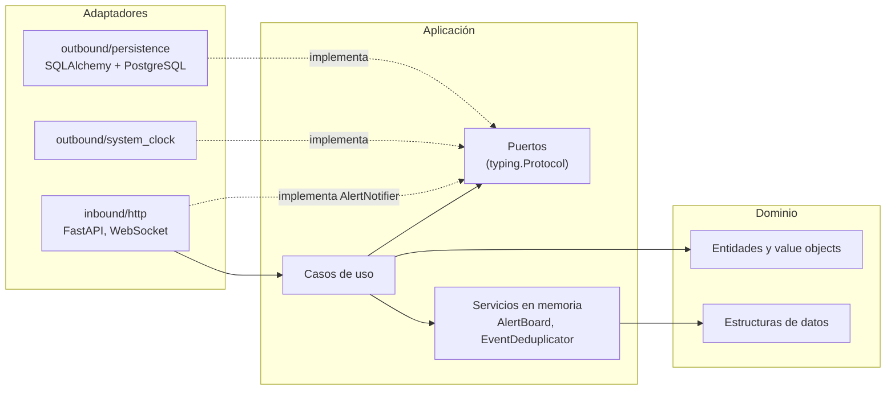
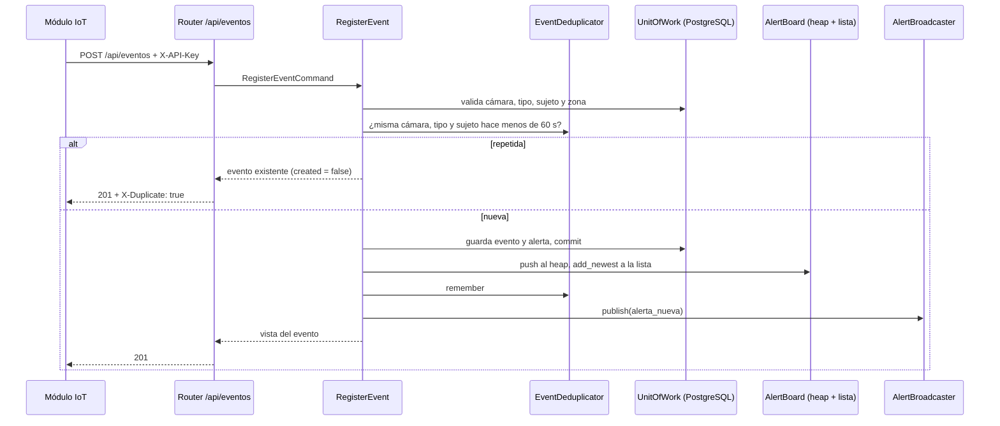
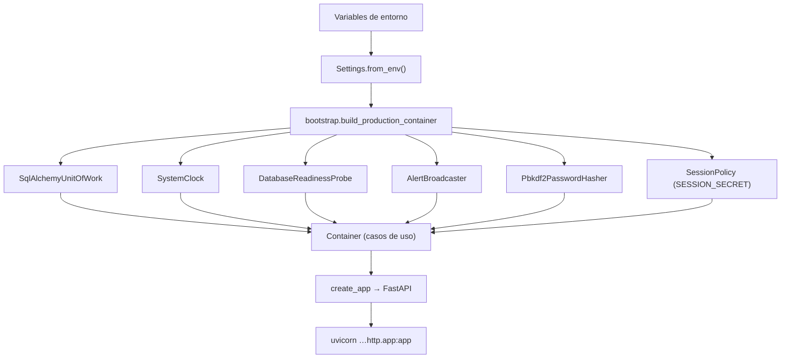

# Arquitectura

El backend sigue la **arquitectura hexagonal** (puertos y adaptadores). La
lógica de negocio queda en el centro, sin saber si los datos vienen de
PostgreSQL o de memoria, ni si la petición llegó por HTTP o por un script.
Las decisiones que llevaron a este diseño están en [docs/adr](adr/).

## Capas y dirección de las dependencias

| Capa | Paquete | Puede importar | No puede importar |
|---|---|---|---|
| Dominio | `safevision.domain` | Solo la biblioteca estándar | Frameworks, `application`, `adapters`, `config` |
| Aplicación | `safevision.application` | `domain` | Frameworks, `adapters`, `config` |
| Adaptadores | `safevision.adapters` | `application`, `domain`, frameworks | — |
| Composición | `safevision.bootstrap` | Todo | — |

La regla no es solo una convención: `tests/architecture/test_layers.py` recorre
con `ast` los imports de cada archivo de `domain` y `application` y falla si
aparece `fastapi`, `pydantic`, `sqlalchemy`, `starlette`, `psycopg`, `dotenv`,
`uvicorn` o una capa exterior. Otra prueba impide DDL (`CREATE TABLE`,
`create_all`…) en todo el código fuente.

## Dominio

`domain/model` contiene las entidades (`Event`, `Alert`, `Camera`, `Zone`,
`Subject`, `EventType`, `Location`) y los value objects (`Severity`, `Priority`,
`EventStatus`, `AlertStatus`, `DetectedClass`, `CameraStatus`, `SubjectType`,
`Confidence`, `ZonePolygon`). Validan sus datos al crearse y expresan las
reglas del negocio:

- `EventStatus` permite `pending → in_review → resolved | false_alarm` y
  `pending → resolved | false_alarm`; `resolved` y `false_alarm` son finales.
- `Severity` 3–4 es prioridad **Alto**, 2 **Medio** y 1 **Bajo**.
- Una zona solo vale para la cámara a la que pertenece.
- Cerrar una alerta exige `attended_at ≥ created_at`, la misma restricción
  que tiene la base.

`domain/structures` contiene las estructuras de datos hechas a mano (ver
[estructuras.md](estructuras.md)).

## Aplicación

### Puertos

| Puerto | Qué abstrae | Adaptador en producción | Adaptador en pruebas |
|---|---|---|---|
| `EventRepository`, `AlertRepository`, `EventTypeRepository`, `CameraRepository`, `CatalogRepository` | Lectura y escritura de cada agregado | Repositorios SQLAlchemy | Repositorios en memoria (`tests/fakes`) |
| `UserRepository` | Usuarios del panel (solo lectura, por id y por correo) | `SqlAlchemyUserRepository` | `InMemoryUserRepository` |
| `PasswordHasher` | Cómo se guardan y verifican las contraseñas | `Pbkdf2PasswordHasher` (600 000 iteraciones) | El mismo con pocas iteraciones |
| `UnitOfWork` | Transacción que agrupa los repositorios | `SqlAlchemyUnitOfWork` (una sesión por hilo) | `FakeUnitOfWork` con rollback real |
| `Clock` | La hora actual | `SystemClock` (UTC) | `FakeClock` controlable |
| `AlertNotifier` | Avisar al panel de alertas nuevas y eventos cerrados | `AlertBroadcaster` (WebSocket) | `RecordingNotifier` |
| `ReadinessProbe` | Si la base responde | `DatabaseReadinessProbe` | `AlwaysReady` |

### Casos de uso

Un archivo por caso de uso en `application/use_cases`:

| Escritura | Lectura |
|---|---|
| `RegisterEvent` (deduplica, crea evento + alerta, avisa) | `ListEvents` (filtros, paginación) |
| `ReviewEvent` y `MarkFalseAlarm` (cierran evento y alertas) | `GetEvent` |
| `MarkAlertSeen` | `GetPendingAlerts` (orden del heap) |
| `UpdateCameraStatus` | `GetRecentEvents` (lista doble) |
| `AuthenticateUser` (login con límite de intentos) | `GetSessionUser` (usuario de la sesión) |
| `RebuildAlertBoard` (al arrancar) | `GetMetrics`, `GetEventTypeStatistics`, `GetCameraStatistics` |
| | `ListEventTypes`, `ListLocations`, `ListCameras`, `ListZones`, `ListSubjects` |

### Servicios en memoria

- `AlertBoard` agrupa el heap de alertas pendientes y el historial reciente
  detrás de un candado, porque el servidor atiende peticiones en varios hilos.
- `EventDeduplicator` descarta las detecciones repetidas del IoT dentro de
  una ventana de tiempo, con una cola enlazada y un diccionario.
- `LoginThrottle` cuenta los inicios de sesión fallidos por correo en una
  ventana de 15 minutos, con la misma combinación de estructuras.

## Flujo de una detección

La memoria se actualiza **después** del commit: si la base falla, ni el heap
ni el deduplicador quedan con un evento que no existe, y el reintento del IoT
no se toma como repetido.

## Adaptadores

**Entrada (HTTP).** `adapters/inbound/http` contiene la fábrica
`create_app(container)`, un router por recurso (`eventos`, `alertas`,
`estadisticas`, `catalogos`, `camaras`, `health`, `auth`), el WebSocket
`/ws/alertas`, los esquemas Pydantic que fijan el contrato JSON y los
middlewares: request-id, registro de acceso sin datos sensibles, cabeceras de
seguridad, límite de tamaño del cuerpo y CORS con credenciales. Los errores del
dominio se traducen a 404, 409 y 422; los de la base, a 503, 409 o 500 sin
detalles internos; los del inicio de sesión, a 401 y 429.

La autenticación es asunto de este adaptador
([ADR 0007](adr/0007-sesion-con-cookie-firmada.md)): `sessions.py` firma y lee
los tokens (cookie `sv_session` y ticket del WebSocket) con HMAC-SHA256, y
`security.py` tiene las dependencias de FastAPI: `require_iot_key`,
`require_session`, `require_panel_access` (sesión o clave) y la comprobación del
`Origin` contra CSRF. La aplicación solo ve correos, contraseñas e ids de
usuario.

**Salida (contraseñas y reloj).** `Pbkdf2PasswordHasher` usa `hashlib` de la
biblioteca estándar; `SystemClock` da la hora en UTC.

**Salida (persistencia).** `adapters/outbound/persistence` mapea las tablas
existentes con modelos ORM separados del dominio; los mappers convierten filas
en entidades (así las reglas del dominio también se validan al leer). La unidad
de trabajo traduce las excepciones de SQLAlchemy a errores de la aplicación.

## Raíz de composición

`bootstrap.py` es el único lugar que conoce a la vez los puertos y los
adaptadores. `build_container` arma los casos de uso alrededor de una unidad de
trabajo, un reloj y un tablero en memoria; `build_production_container` le pasa
PostgreSQL y el reloj del sistema. Las pruebas usan la misma función con
adaptadores en memoria, y las pruebas de contrato corren las mismas peticiones
contra ambas configuraciones.

